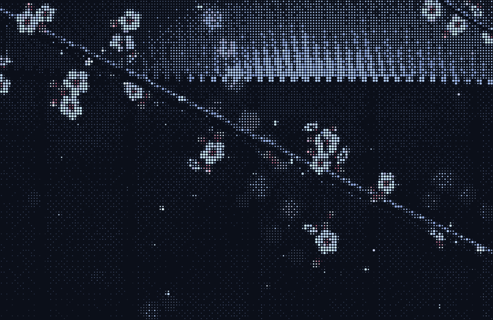

# Mac ASCII Art: Plum Blossom Night

A living ASCII-art wallpaper for your Mac. A branch of plum blossom crosses in
front of a temple roof at night, drawn as a halftone of dots in the colours of
the original photo: deep navy, slate, the pale blue of the lit roof, icy white
petals with raspberry hearts.



What moves:

- **The breeze** comes and goes in gusts. The branch bends with it and the hanging sprays swing.
- **Petals** let go of the open blossoms, more in a gust, and drift down across the screen.
  A few pass close to the "camera", big and soft.
- **Dew** on the bark catches the light and twinkles.
- **Mist** drifts over the dark facade, and cloud shadow moves slowly over the roof.

It's one HTML file with no dependencies (`index.html`), drawn on a canvas at 15 frames a second.
It redraws only the dots that change, so it's light on CPU.

## Set it as your Mac wallpaper

macOS can't use an animated web page as a wallpaper on its own. The free app **Plash** fills that
gap: it shows any website (online or a local file) as your desktop wallpaper, behind your icons.

1. **Install Plash** (free) from the Mac App Store: <https://apps.apple.com/app/plash/id1494023538>
2. **Get a link to the wallpaper**, either way works:
   - **Online (easiest):** in this repository on GitHub open **Settings → Pages**. Under
     *Build and deployment* choose **Deploy from a branch**, pick the branch with these files and
     **/ (root)**, then **Save**. After a minute or so it's live at
     <https://shyboy0499.github.io/Mac-ascii-art/>
   - **Offline:** download this repo (**Code → Download ZIP**), unzip it somewhere it will stay
     (for example `~/Pictures/Mac-ascii-art`), and use its `index.html`.
3. **Add it in Plash:** click Plash's icon in the menu bar → **Add Website**, paste the link (or
   choose the local `index.html`), and it becomes your wallpaper.

To check the link first, open it in Safari.

Plash has two limits worth knowing:

- It shows the page on **one display only**, the one picked in its settings.
- It leaves out the **menu bar strip** at the top of the screen. If you hide the macOS menu bar
  (for example behind SketchyBar), your old wallpaper shows through there. Setting the normal macOS
  wallpaper to the solid colour `#0B0F19` (System Settings → Wallpaper → Colors → Add Color) makes
  that strip match.

### Every display, edge to edge: the built-in helper

`macos/wallpaper.swift` is a small native helper that does what Plash can't. It shows the page on
**every display**, covering the **whole screen including behind the menu bar**, under your desktop
icons and on every Space. Clicks go straight through to the desktop.

It needs the Xcode command line tools (`xcode-select --install` if `swiftc` is missing). Quit
Plash first so the two don't stack. Then run this from the repository folder:

```sh
swiftc -O macos/wallpaper.swift -o ascii-wallpaper
./ascii-wallpaper                              # this folder's index.html
./ascii-wallpaper "index.html?fps=10&petals=2" # with options
./ascii-wallpaper "ascii-rest.html?piece=lantern-lake"
```

Ctrl-C stops it. To keep it running after you close the terminal, use
`nohup ./ascii-wallpaper >/dev/null 2>&1 &`, and stop it with `pkill ascii-wallpaper`.

### Tweaks

Add options to the end of the link, like
`https://shyboy0499.github.io/Mac-ascii-art/?fps=10&petals=2`:

| Option   | Default | What it does |
|----------|---------|--------------|
| `cell`   | `8`     | Size of each dot cell in points. Smaller is finer and uses more CPU. |
| `fps`    | `15`    | Frames per second. `10` saves battery and still looks smooth. |
| `petals` | `1`     | How many petals fall. `0` for none, `2` or `3` for a flurry. |
| `wind`   | `1`     | Strength of the breeze. `0` for still air. |
| `seed`   | `7`     | A different arrangement of the blossoms. |
| `ramp`   | `dots`  | `ascii` draws with the characters ` .:-=+*#%@` instead of dots. |
| `still`  | off     | `1` draws a single frame and stops: a static wallpaper with no CPU use. |

## Any ascii.rest piece as a wallpaper

[ascii.rest](https://ascii.rest) (by [bas3line](https://github.com/bas3line), MIT licensed) has
over 200 moving ASCII pieces. Its HTML, React, Astro, TypeScript and terminal versions are all
ways to put a piece into *your own* site, app or terminal. For a wallpaper you just need a page that
plays one full screen, and that's `ascii-rest.html`:

```
https://shyboy0499.github.io/Mac-ascii-art/ascii-rest.html?piece=lantern-lake
```

Use the name from the piece's ascii.rest address (`ascii.rest/lantern-lake/` → `lantern-lake`), and
add `&fps=12` to change its frame rate. It loads the `ascii.rest` package from the jsDelivr CDN, so
it needs to be online. Paste that link into Plash the same way.

## How it works

Every frame, each cell of a square grid is shaded in colour: the roof, the eaves and the facade
(worked out once), then the drifting mist, the blurred blossoms behind, the bark with its rim of
light, the blossoms and the falling petals. Each cell then becomes one halftone dot. The dot's
size is the cell's brightness, with an ordered dither, and its colour is the nearest one in a
palette sampled from the original wallpaper photo. Dots are drawn once into an atlas and copied
into place, and only cells that changed get redrawn.
